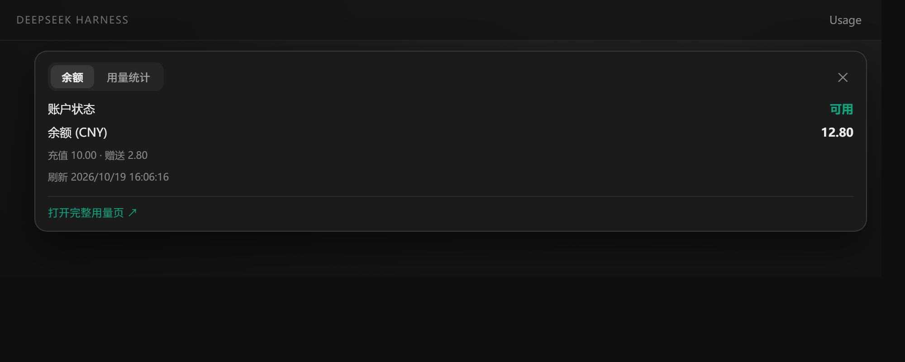
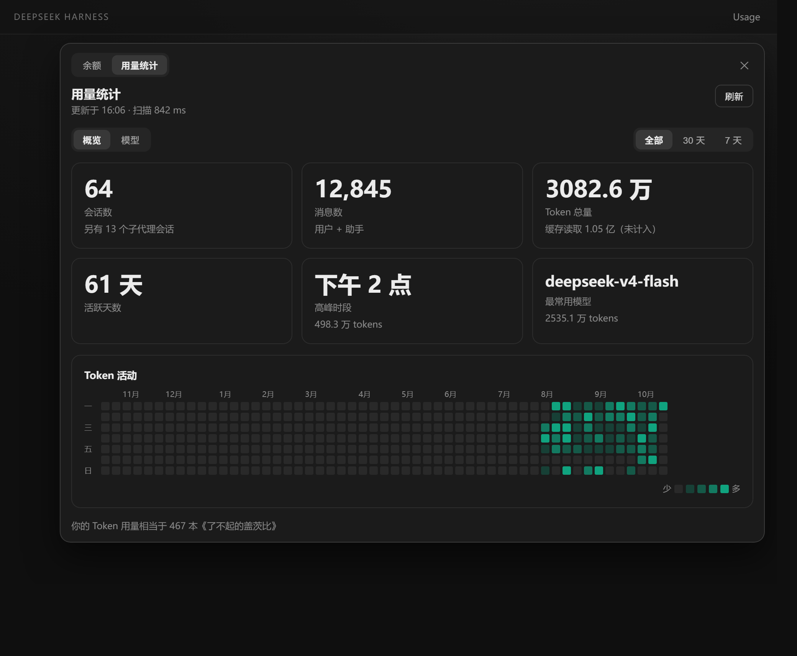

# dsh-client-ui-usage

[简体中文](README.md) | English

A client plugin for **DSH (DeepSeek Harness)**: it adds a **Usage** button to the conversation header. Clicking it opens a two-tab panel.

- **Balance** — reads the official `GET /user/balance` endpoint with your DeepSeek API key. The key never leaves the host process; the browser only calls the same-origin `/usage-balance` route. When the balance drops below `0.5` the number turns red and gets a ❗.
- **Usage stats** — scans local session logs: a 3×2 metric grid, a 53-week × 7-day token heatmap, Overview / Models tabs, All / 30 days / 7 days range switching, and an "equivalent to N copies of *The Great Gatsby*" easter egg. Visually modelled on Claude's Usage page.

## Screenshots

> Sample data, not real usage.

**Balance** — account status, per-currency balance, top-up and bonus breakdown. Below 0.5 the value turns red with a ❗.



**Usage stats** — 3×2 metric cards, 53-week token heatmap (5-step single-hue scale with a less/more legend), Overview / Models tabs, range switching.



## Install

### Requirements

- DSH desktop app (verified on `0.2.1-rc.2`)
- Node.js 22+ (the host half uses `zlib.zstdDecompressSync` to decompress session logs)

### Option A: patch-layer insert (recommended)

1. Put this repo somewhere, e.g. `<plugin-dir>/dsh-client-ui-usage`
2. Edit `<DSH_HOME>/profiles/<profile>/package.json` and add the dependency:

   ```json
   "dependencies": {
     "dsh-client-ui-usage": "link:<plugin-dir>/dsh-client-ui-usage"
   }
   ```

3. Edit `cordis.patch.yml` in the same profile directory:

   ```yaml
   - insert:
       - id: ui-usage
         name: 'dsh-client-ui-usage'
   ```

4. Run `pnpm install` inside that profile directory
5. **Restart** DSH

### Option B: bundles

Append `"dsh-client-ui-usage"` to `dsh.profile.bundles` (and make sure it is referenced in `dependencies`). This package ships its own `cordis.patch.yml`, so the insert happens automatically once it is listed as a bundle.

> Client plugins are scanned and registered **once at process start**: after changing anything, restart the process. Reloading the page is not enough.

## Configuration

The balance tab needs `DEEPSEEK_API_KEY`, resolved in this order:

1. Environment variable `DEEPSEEK_API_KEY`
2. `DEEPSEEK_API_KEY` in `<DSH_HOME>/.credentials.yaml`

Without a key the **Usage stats** tab still works; only the balance tab reports the missing key.

## Metric definitions

| Metric | Definition |
|---|---|
| Sessions | Sessions in range, **excluding subagent sessions** (`delegationDepth > 0`); the excluded count is shown under the card |
| Messages | `user/message` + `assistant/message` events |
| Total tokens | `inputTokens + outputTokens`; `cacheReadTokens` is tracked **separately and excluded** (same as Claude) |
| Active days | Distinct local dates with token usage |
| Peak hour | Largest token bucket over local-hour buckets |
| Top model | Argmax over tokens |

Only `assistant/message` `usage` is counted. **`assistant/chunk` / `*-chunks` are never summed** — those are streaming fragments and summing them would double-count.

## Implementation notes

- Session logs live under `<DSH_HOME>/sessions/<escaped-cwd>/session-<uuid>/` and may be stored as `session.full.jsonl`, `session.jsonl`, or **`session.jsonl.zstd`** (concatenated zstd frames).
- Multi-frame zstd is a real trap: Node's `zstdDecompressSync` **and** the streaming decompressor only handle the first frame (a 47 KB log decodes to just the 150-byte session header). This plugin splits on the frame magic and decodes frame by frame, merging a segment into the next frame when decoding fails.
- The host half keeps a `path → mtime/size → aggregate` index and persists it to `<DSH_HOME>/.cache/usage-stats.json`: ~7 s cold scan over 100 MB of logs, ~60 ms warm start, then incremental by mtime.
- The cache stores aggregates only — **no conversation content**.
- Session roots are discovered, not hard-coded: `DSH_SESSIONS_DIR`, then `DSH_HOME`, then the profile path from the process arguments, then `.dsh` walking up from the working directory, then `~/.dsh`; the most recently active root wins.

## Layout

```
dsh-client-ui-usage/
├── package.json
├── cordis.patch.yml      # bundle patch for the bundles install path
└── lib/
    ├── index.js          # host: /usage-balance proxy, /usage-stats session scan
    └── client.js         # client: UsageButton (balance/stats panel) + dashboard
```

## Routes

| Route | Description |
|---|---|
| `GET /usage-balance` | Proxies the DeepSeek balance endpoint, returns `{ ok, is_available, balance_infos }` |
| `GET /usage-stats[?refresh=1]` | Returns the full aggregate payload (session array + day buckets + model list); range filtering happens in the frontend |

## Known limitations

- The heatmap is always 53 weeks; switching range dims out-of-range cells rather than cropping.
- Clicking a day to list that day's sessions is not implemented yet.
- Balance lookup supports DeepSeek official only (`api.deepseek.com`).

## License

MIT
